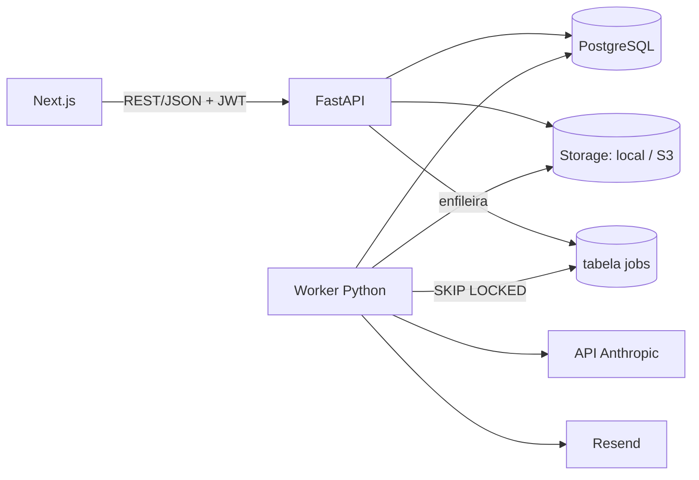

# 02 — Arquitetura

## Visão geral



O trabalho lento ou externo (OCR, correção e e-mails) **sempre roda no worker**. A API só valida, persiste e enfileira. O frontend acompanha o status por *polling* em `GET /essays/{id}` a cada 3 s enquanto o status for `transcribing` ou `grading`. SSE fica como melhoria futura.

## Estrutura de pastas

```
.
├── CLAUDE.md
├── docker-compose.yml
├── .env.example
├── db/schema.sql                 # referência do modelo
├── docs/
├── backend/
│   ├── pyproject.toml
│   ├── alembic/
│   ├── app/
│   │   ├── main.py
│   │   ├── core/                 # config (pydantic-settings), db, security, deps, errors
│   │   ├── storage/              # interface Storage + LocalStorage + S3Storage
│   │   ├── ai/
│   │   │   ├── client.py         # wrapper Anthropic + registro em ai_usage
│   │   │   ├── transcription.py
│   │   │   ├── grading.py
│   │   │   └── prompts/          # transcricao.md, correcao_sistema.md, rubrica.md
│   │   ├── email/                # cliente Resend + templates (Jinja2 HTML)
│   │   ├── jobs/                 # enqueue(), handlers registrados por nome
│   │   ├── worker/               # __main__.py: loop + agendador de lembretes
│   │   └── modules/
│   │       ├── auth/
│   │       ├── users/
│   │       ├── essays/
│   │       ├── questions/
│   │       ├── planner/
│   │       └── stats/
│   ├── scripts/                  # import_questions.py, eval_grading.py, seed.py
│   └── tests/
└── frontend/
    ├── app/                      # (auth)/, redacoes/, questoes/, cronograma/, painel/
    ├── components/
    └── lib/api.ts                # cliente tipado (gerado do OpenAPI com openapi-typescript)
```

## Fila de jobs (Postgres)

Tabela `jobs` (ver schema). Funcionamento:

- `enqueue(queue, payload, run_after=now())` insere uma linha `pending`.
- O worker roda em loop:
  ```sql
  UPDATE jobs SET status='running', locked_at=now(), attempts=attempts+1
  WHERE id = (
    SELECT id FROM jobs
    WHERE status='pending' AND run_after <= now()
    ORDER BY run_after
    FOR UPDATE SKIP LOCKED
    LIMIT 1)
  RETURNING *;
  ```
- Se der certo, `done`. Se der erro, volta para `pending` com backoff exponencial (`run_after = now() + 2^attempts * 30s`) até `max_attempts`, e depois vira `failed`.
- Jobs presos em `running` há mais de 10 min voltam para `pending` (recuperação de crash).
- Filas: `essay.transcribe`, `essay.grade`, `email.send`, `planner.reminders_tick`.
- **Agendador**: a cada minuto, o worker enfileira os lembretes dos blocos que começam em `reminder_minutes_before` minutos no fuso de cada usuário. A deduplicação é feita por `email_logs.dedupe_key = 'reminder:{block_id}:{data_local}'`.

## Pipeline da redação (resumo; detalhes em `05`)

```
upload → [API] salva original no storage, cria essay(uploaded), enfileira essay.transcribe
       → [worker] pré-processa imagem → Claude (visão) → transcription_raw → status awaiting_review
       → [aluno] revisa e confirma → [API] salva transcription_text, status grading, enfileira essay.grade
       → [worker] checagens objetivas → 2 correções independentes → 3ª se discrepante
                  → consolida em essay_results → status graded → e-mail "correção pronta"
```

### Pré-processamento de imagem (OpenCV)
1. Aplicar a orientação EXIF.
2. Detectar o contorno da folha e fazer a transformação de perspectiva (recorte).
3. Corrigir a inclinação (deskew).
4. Leve ajuste de contraste (CLAHE). **Não binarizar agressivamente**, porque a IA lê melhor uma imagem natural.
5. Redimensionar para o limite recomendado pela documentação de visão da Anthropic (consultar o valor atual) e salvar como JPEG com qualidade 90.
6. Guardar original e processada (`essay_images.original_storage_key` / `storage_key`).

## Autenticação
- Senha com **argon2** (`argon2-cffi`).
- Access token JWT (15 min) no header `Authorization: Bearer`.
- Refresh token opaco (30 dias) em cookie `httpOnly`, `Secure`, `SameSite=Lax`. Só o hash fica em `refresh_tokens`. Há rotação a cada uso.
- Tokens de e-mail (verificação/reset) aleatórios, com apenas o hash no banco, de uso único e expiração de 24 h / 1 h.
- Rate limit simples em `/auth/*` (ex.: `slowapi`).
- Usuário com e-mail não verificado pode navegar, mas não enviar redação.

## E-mails (Resend)
- `app/email/client.py` expõe `send(to, subject, html, dedupe_key=None)`, que **sempre** é chamado via job `email.send`.
- Templates Jinja2 em `app/email/templates/`: `verify_email.html`, `reset_password.html`, `essay_graded.html`, `study_reminder.html`.
- Todo envio é registrado em `email_logs` com o `id` retornado pelo Resend.
- Todos os e-mails de lembrete têm link de descadastro (desliga `users.email_reminders_enabled`).

## Custos e limites de IA
- `ai_usage` guarda tokens por chamada (incluindo cache) e o custo estimado.
- Use **prompt caching** no prompt de sistema da correção (rubrica longa e estática). Isso reduz bastante o custo das execuções repetidas.

## Observabilidade
- Logs estruturados (JSON) com `essay_id` e `job_id`.
- `GET /health` (db + storage).
