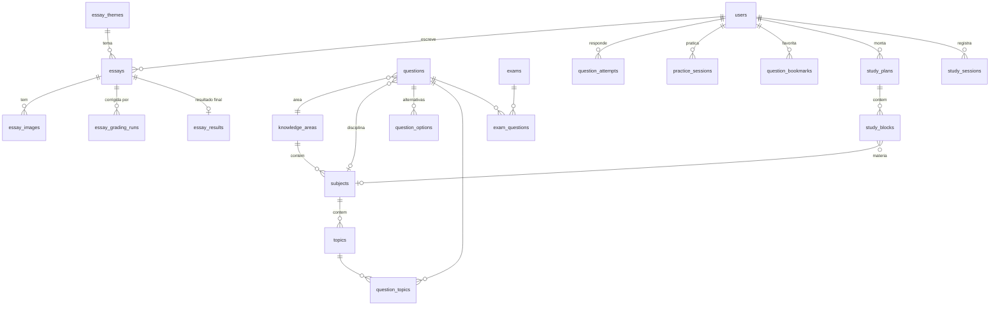

# 03 — Banco de dados (PostgreSQL 16)

O DDL completo está em `db/schema.sql`. Ele foi testado aplicando-o em um PostgreSQL 16 limpo. Este documento explica as decisões. Na implementação, crie os models SQLAlchemy e a **migration inicial do Alembic** a partir desse arquivo, mantendo nomes, tipos e constraints.

## Mapa de domínios



## Decisões importantes

### Usuários e auth
- `email` é `citext`, então `A@x.com` e `a@X.com` são o mesmo usuário.
- Tokens (refresh, verificação, reset) guardam **apenas o hash** (SHA-256). O valor em claro só existe no cookie ou no link do e-mail.
- `birth_date` e `guardian_consent_at` servem para cumprir a LGPD com menores.
- `timezone` (IANA) é usado nos lembretes do cronograma.

### Redações
- `essays.status` é a máquina de estados do pipeline: `uploaded → transcribing → awaiting_review → grading → graded`, com qualquer etapa podendo ir para `failed`. Redações digitadas (`input_type = 'text'`) vão direto para `grading`.
- `transcription_raw` (jsonb) é a saída bruta da IA, guardada para auditoria e comparação com o texto revisado. `transcription_text` é o texto **confirmado pelo aluno**, e é ele que vai para a correção.
- `essay_grading_runs` guarda cada correção independente, como se fosse um "corretor". As notas são restritas a `0/40/80/120/160/200` por CHECK. Uma redação anulada obriga todas as notas a zero e exige `zero_reason`.
- `essay_results` guarda o resultado consolidado exibido ao aluno. As notas aqui são médias, por isso aceitam qualquer valor entre 0 e 200 (ex.: 140).
- `total` é coluna gerada (`GENERATED ALWAYS ... STORED`) e nunca é escrita pela aplicação.

### Banco de questões
- **Uma questão é armazenada uma vez**, identificada por `inep_item_code` (CO_ITEM dos microdados). O mesmo item aparece em cadernos de cores diferentes com outra numeração, o que fica em `exam_questions(exam_id, question_id, position)`.
- `area_id` é obrigatório. `subject_id` e os tópicos podem ficar vazios na importação e são classificados depois (manualmente ou com ajuda da IA, ver roadmap).
- Os parâmetros TRI (`irt_a`, `irt_b`, `irt_c`) vêm dos microdados. `irt_b` serve como filtro de dificuldade. Sugestão de faixas para a interface: fácil `< 0.5`, média `0.5–1.5`, difícil `> 1.5`; calibre olhando a distribuição real.
- `is_annulled`: questões anuladas pelo INEP ficam sem gabarito e fora dos filtros padrão.
- **Busca textual**: `search_vector` é gerado com a configuração `pt_unaccent` (português + `unaccent`), indexado com GIN. Consulta:
  ```sql
  SELECT id FROM questions
  WHERE search_vector @@ websearch_to_tsquery('pt_unaccent', :q)
  ORDER BY ts_rank(search_vector, websearch_to_tsquery('pt_unaccent', :q)) DESC;
  ```
  Ignora acentos e plurais regulares. O plural irregular -ão/-ões ("função" × "funções") não casa. Se isso incomodar, complemente com `pg_trgm`.
- `question_attempts` registra **todas** as tentativas, inclusive repetidas. As estatísticas de acerto usam a **última tentativa por questão** ou todas, conforme a tela (deixe explícito na API).
- O filtro "não respondidas" usa `NOT EXISTS` em `question_attempts` com `(user_id, question_id)`, coberto por `idx_attempts_user_question`.

### Cronograma
- `weekday` segue a ISO 8601: **1 = segunda … 7 = domingo**. No Python, `date.isoweekday()`.
- `start_time`/`end_time` são `time` sem fuso. São interpretados no `users.timezone`.
- **Sobreposição**: validada no `service` antes de inserir/atualizar. A regra é `novo.start < existente.end AND novo.end > existente.start` no mesmo `plan_id` e `weekday`, excluindo o próprio bloco no update. Retorne 409 com o bloco conflitante. Um bloco que termina às 10:00 não conflita com outro que começa às 10:00.
- Um único cronograma ativo por usuário, garantido pelo índice único parcial `uq_study_plans_active`. Para ativar outro, faça na mesma transação: desativa todos e ativa o escolhido.
- `grid_start`/`grid_end` definem só a faixa exibida na tabela, não restringem os blocos.

### Infra
- `ai_usage`: uma linha por chamada à Anthropic. É a base para acompanhar custo e depurar.
- `email_logs.dedupe_key` (UNIQUE) impede lembretes duplicados: insira o log **antes** de enviar, com `ON CONFLICT DO NOTHING`, e só envie se a linha foi inserida.
- `jobs`: ver `02-arquitetura.md`.

## Seed
O schema já insere as 4 áreas e as disciplinas principais. Crie `scripts/seed.py` para:
- tópicos iniciais por disciplina (ex.: Matemática → Funções, Geometria plana, Estatística, Probabilidade…);
- temas oficiais de redação dos anos anteriores (título + ano; textos motivadores opcionais);
- um usuário admin de desenvolvimento.

## Consultas de referência

Acerto por área (última tentativa de cada questão):
```sql
WITH last AS (
  SELECT DISTINCT ON (question_id) question_id, is_correct
  FROM question_attempts
  WHERE user_id = :uid
  ORDER BY question_id, answered_at DESC
)
SELECT ka.code, count(*) AS respondidas,
       round(100.0 * avg(last.is_correct::int), 1) AS pct_acerto
FROM last
JOIN questions q ON q.id = last.question_id
JOIN knowledge_areas ka ON ka.id = q.area_id
GROUP BY ka.code;
```

Horas planejadas por área no cronograma ativo:
```sql
SELECT coalesce(ka.code, 'OUTRO') AS area,
       sum(extract(epoch FROM b.end_time - b.start_time)) / 3600 AS horas_semana
FROM study_blocks b
JOIN study_plans p ON p.id = b.plan_id AND p.is_active AND p.user_id = :uid
LEFT JOIN subjects s ON s.id = b.subject_id
LEFT JOIN knowledge_areas ka ON ka.id = coalesce(b.area_id, s.area_id)
GROUP BY 1;
```
